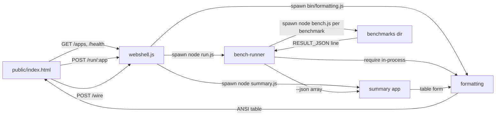

# Architecture

One repository, five packages, three roots, zero daemons.

## Repository layout

```
stateless-engineering/
├── package.json              # npm workspace root; scripts: bench:all, bench:one, webshell, test, ticket
├── packages/
│   ├── webshell/             # the app runtime & compositor (webshell.js)
│   │   ├── webshell.js       #   HTTP server: discovery, /run, /wire, /settings
│   │   ├── apps/summary/     #   transformer app: RESULT_JSON array → table form
│   │   └── public/           #   the terminal UI
│   ├── bench-runner/         # stateless CLI: every */bench.js → RESULT_JSON summary
│   ├── formatting/           # pretty ANSI box tables; consumed by bench-runner in-process
│   ├── benchmarks/           # the store: one dir per benchmark with bench.js
│   │   └── lib/common.js     #   shared: launch, serveFixture, treeRssKb, snapshot/restore
│   └── ticket/               # stateless ticket CLI: GitHub issues as a job queue
│       ├── lib/flow.js       #   the state machine (pure, zero-dep)
│       ├── lib/gh.js         #   gh subprocess wrapper
│       ├── bin/ticket.js     #   14 verbs: list/next/new/triage/claim/review/close/...
│       └── actions/          #   the flow GitHub Action (issue hygiene + close enforcement)
├── docs/
│   ├── architecture.md       # this file
│   ├── adr/                  # recorded decisions (0001–0004)
│   ├── wiki/                 # the knowledge base (mirrored to the GitHub wiki)
│   └── specs/                # the platform architecture: 13 specs, one blob contract
│       └── projects/         #   FOSS family per-project specs
├── tasks/                    # plan.md + todo.md — the org's execution tracks (A–E)
├── notes/                    # provenance chat-log exports
└── .github/                  # issue templates + CI/workflow: ci, flow (tickets), wiki
```

The org's platform architecture lives in `docs/specs/` — the spec family
defines the state-blob contract, the tab runtime, the browser rebuild, the
ticket flow, the language strategy, and the platform expansion (mesh,
compute, VMs, gaming, native apps, AI). This file covers the monorepo's
implemented core.

## Data flow



## Discovery = path resolution

- `webshell.js` scans three roots for `app.json` manifests (or legacy
  `bench.js`): its own `apps/`, `packages/benchmarks/`, and `packages/`.
- A service exists if its directory is on disk. No registry, no config.
- **"Down" is the default** — every app is a short-lived process spawned per
  request, gated on exit code, reaped on disconnect.

## Stateless guarantees

- Temp files → `os.tmpdir()` with `try/finally` + `process.on('exit')` cleanup.
- Ephemeral ports (webshell binds 0 by default; benchmarks bind 0).
- Sorted discovery ordering; no ambient state; no generated artifacts in git.
