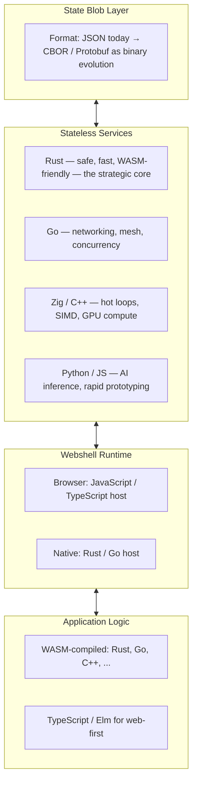

# Spec: Language Strategy for the Stateless Platform

Tracked as issue #12. Answers the question the platform specs leave open:
**what do we build it in?** The answer is the deeply satisfying one — there
isn't a single optimal language, and that's the point. The state blob is a
protocol, services are implementations, and the webshell is a host. The
architecture enforces no global language choice; each layer picks the
language that best fulfills its contract.

This spec is the companion to the stateless browser rebuild
(`docs/specs/stateless-browser.md`) — its open question 1 (engine base) is
answered here with the platform-wide view — and to the FOSS family
(`docs/specs/foss-projects.md`).

## The meta-principle

> Services are black boxes behind the state-blob contract. A physics service
> written in Zig can be swapped for a Rust rewrite without touching the rest
> of the system. A mesh relay can be Go today and Rust tomorrow. The optimal
> language is the one that best fulfills that service's contract — and the
> architecture enforces no global choice.

The one universal interface is the **state blob** (see the tab-runtime spec:
versioned, hashed, content-addressed, encrypted-able). Any service in any
language that can read and write the schema can participate.

## The layer map



## 1. State blob — the universal interface

The blob is **data**, not code. Its format must be:

- **Language-agnostic** — readable by any service.
- **Efficient to serialize/deserialize** — for hibernation and mesh sync.
- **Schema-evolvable** — forward and backward compatible.

The org's blob is already versioned + hashed, so encoding can evolve without
breaking restores. Strategy:

- **Now: JSON** (the tab-runtime layer-0 format) — debuggable, zero-dep,
  diff-friendly; correctness of the schema matters more than bytes today.
- **Evolution: CBOR, then Protobuf/FlatBuffers** — when hibernation size or
  mesh sync bandwidth demands it, the same versioned schema re-encodes
  (schema v2, binary payload). The hash covers the payload, so encodings are
  verifiable independently of their representation.

No single language owns the blob; it is a contract. The format choice is
decoupled from every implementation.

## 2. Stateless services — Rust default, purpose-built alternatives

Services must be pure (same input → same output, no hidden state), which the
stateless contract already demands. Language fit:

| Layer | Language | Why |
|---|---|---|
| Core platform (engine, runtime, blob store) | **Rust** | Ownership/borrowing enforce purity at compile time (no accidental mutable globals); memory safety for a kernel-hardened base runtime; WASM portability; the strategic bet |
| Mesh (peer discovery, WebRTC signaling, relay) | **Go** | Goroutines + stdlib for network-heavy services; small binaries, tiny containers |
| Hot loops, SIMD, GPU interop (physics, AI runtimes) | **Zig / C++** | Hand-tuned performance; expose a pure C ABI wrapped by a Rust/WASM interface |
| AI inference | **Python** | PyTorch / ONNX ecosystems; served as stateless RPC endpoints (gRPC) — the webshell calls them like any other service |
| Prototyping, tooling, integration | **JS/TS, Node** | The org's existing packages (webshell, bench-runner, formatting, ticket) — valid as long as they speak the blob contract |

A render service in Rust:

```rust
// service contract: (state blob, input) → (new blob, outputs)
fn render(blob: &[u8], input: &Input) -> Result<Output> {
    let state = State::decode(blob)?;   // schema-verified
    let output = project(state);        // pure: same in → same out
    Ok(output)
}
```

## 3. Webshell runtime — polyglot host

The webshell orchestrates state management, service dispatch, and
progressive restoration.

- **In the browser: JavaScript/TypeScript, unavoidably** — it must interact
  with the DOM, WebRTC, and Web Workers.
- **Native (Electron replacement / OS process): Rust** — embeds V8 or a
  WASM runtime for user code, gives the host process memory safety, and is
  the same language as the core services (one toolchain across the
  platform).

The host is a dispatcher, not a religion: it speaks the blob protocol to
services in any language.

## 4. Application logic — compile to WASM

Application developers write UI logic and state reducers in **any language
that compiles to WASM** (or JavaScript for web compatibility). The state
blob is the app's output; the render service projects it. Strongly-typed
languages with good serialization support (Rust, Go, C#, Haskell via GHC
WASM) are natural fits — state correctness becomes statically enforced.

## Reconciliation with the existing specs

- **Blob format** — the tab-runtime spec's layer-0 blob is JSON; this spec
  keeps JSON-first and defines the binary evolution path (CBOR →
  Protobuf/FlatBuffers) inside the same versioned, hashed envelope. No
  contradiction.
- **Browser engine base** — the browser spec's open question 1 recommends a
  memory-safe, embeddable engine (Servo-class). Servo is Rust; the Rust-core
  recommendation here *is* that engine path. The phase-6 research picks the
  concrete engine; this spec supplies the platform-wide rationale.
- **FOSS family** — stateless-issues/actions/queue are Node/JS today; that is
  the "tooling/prototyping" row of the service table, valid under the
  meta-principle. Track C's queue core is deliberately pure JS (zero-dep);
  it does not need to be Rust to be correct.

## Boundaries

- **Always:** the state blob is the only contract; schema changes go through
  the blob's versioning; services stay pure; the six stateless rules.
- **Ask first:** changing the blob's binary encoding (schema v2); a new
  core-platform language (Rust is the default — deviation needs a case);
  choosing the engine in the browser spec (phase-6 research, informed by
  this spec).
- **Never:** a language mandate for services (the meta-principle); a blob
  format owned by one language; services that speak anything other than the
  blob contract.

## Open questions

1. **Binary encoding order** — CBOR first (incremental, no codegen) vs
   Protobuf first (schema-first, codegen, RPC-ready)? Default: CBOR when
   bytes matter, Protobuf only if gRPC joins the mesh.
2. **WASM ABI** — which ABI for app logic (component model vs plain
   wasm32)? Default: investigate the component model at D1; it matches
   "services as black boxes" most directly.
3. **Native webshell timeline** — JS/TS browser host is v1; when does the
   Rust native host (Electron replacement) enter the roadmap? Default: after
   D3 (the stateless browser), when a native host earns its keep.
4. **AI services** — Python behind gRPC now, or ONNX Runtime in Rust later?
   Default: Python now (ecosystem), swap when the contract demands it — the
   meta-principle makes that a service-local change.

## Non-goals

- No framework or language mandate for application developers.
- No rewrites of working services (Node tooling stays Node).
- No new blob encoding until the benchmark gates say bytes matter.
