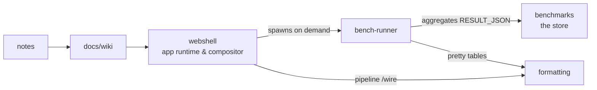

# Wiki

The knowledge base of stateless-engineering — why the org exists, what the
model is, and how the pieces wire together.

## Pages

- [Stateless model](stateless-model.md) — the core discipline: state is truth,
  engines are pure functions, "down" is the default.
- [Tab hibernation](tab-hibernation.md) — the browser idea that started it
  all: cache the rendered state + runtime of a background tab, restore
  instantly.
- [The compositor](compositor.md) — how the webshell wires stateless apps
  into pipelines (`/wire`).

## Quick map

Everything in one repository; every process short-lived; nothing left behind.
