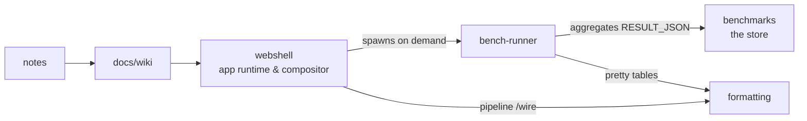

# Wiki

The knowledge base of stateless-engineering — why the org exists, what the
model is, and how the pieces wire together.

## Pages

- [Stateless model](stateless-model.md) — the core discipline: state is truth,
  engines are pure functions, "down" is the default.
- [Tab hibernation](tab-hibernation.md) — the browser idea that started it
  all: cache the rendered state + runtime of a background tab, restore
  instantly.
- [The compositor](compositor.md) — how the webshell wires stateless apps
  into pipelines (`/wire`).
- [Architecture](architecture.md) — the monorepo layout and the stateless
  contract.

## Specs (the platform)

The org's architecture lives in `specs/` (mirrored from `docs/specs/`):

- [Tab runtime](specs/stateless-tab-runtime.md) — the flagship: hibernate a
  tab as a state blob; benchmark-gated.
- [Stateless browser](specs/stateless-browser.md) — the destination: a
  ground-up browser where the stateless model is the architecture.
- [Audit layer](specs/audit-layer.md) — the phase-6 research gate:
  record-replay vs heap snapshot, engine choice, the journal contract.
- [ADRs](adr/) — the recorded decisions (ticket store, JSON-first blob,
  Rust/Tauri, wiki mirror).
- [Ticket flow](specs/stateless-tickets.md) — GitHub issues as a stateless
  job queue (this repo's own dev workflow).
- [Language strategy](specs/stateless-languages.md) — no global optimal
  language; Rust core, blob as the only contract.
- [Platform expansion](specs/stateless-mesh.md) · [compute](specs/stateless-compute.md)
  · [VMs](specs/stateless-vm.md) · [gaming](specs/stateless-gaming.md) ·
  [native apps](specs/stateless-native-apps.md) · [AI](specs/stateless-ai.md)
  — mesh compute, auto decomposition, cloud-compute VMs, Steam-class GPU
  services, Tauri-class native apps, distributed inference — one blob
  contract.
- [FOSS family](specs/foss-projects.md) — the ticket idea built out into
  standalone FOSS projects.

## Quick map

Everything in one repository; every process short-lived; nothing left behind.
